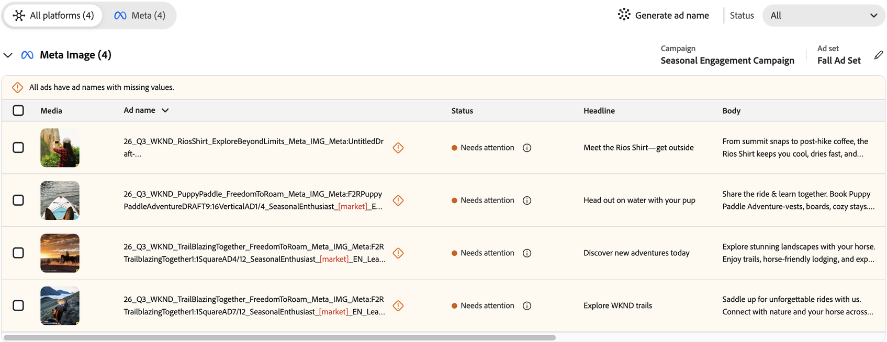

# Genera nomi di annunci

La denominazione automatica degli annunci in [!DNL GenStudio for Performance Marketing] ti consente di seguire le convenzioni di denominazione della tua organizzazione quando attivi gli annunci. I nomi coerenti supportano il reporting delle prestazioni, l’attribuzione e la riconciliazione della spesa.

Carica la convenzione di denominazione per creare un modello, quindi utilizzalo per generare nomi dai metadati dell&#39;esperienza. Rivedi i risultati e apporta eventuali correzioni prima di inviare annunci alle piattaforme.

## Prima di iniziare

La configurazione del modello è un&#39;attività occasionale. Se alla tua piattaforma è già stato assegnato un modello nel progetto corrente, passa a [Genera nomi per un&#39;attivazione](#generate-names-for-an-activation).

Per l&#39;impostazione dei modelli, preparare un file Excel di dimensioni non superiori a 3 MB con un solo foglio. I file CSV non sono supportati. Descrivi la convenzione di denominazione per singoli annunci, non campagne o gruppi di annunci.

Includi i campi nell’ordine richiesto, i valori consentiti, i codici corrispondenti e le istruzioni per la scelta dei valori. Se ad esempio si seleziona `Image` per il campo `format`, nel nome verrà restituito `IMG`.

Scarica l&#39;esempio della convenzione di denominazione di [WKND Meta (Excel)](assets/wknd-meta-naming-convention.xlsx) per esplorare una struttura di esempio. Include le definizioni dei campi e i valori di esempio per anno, trimestre, marchio, prodotto, campagna, piattaforma, formato, versione creativa, persona, mercato, lingua e CTA.

Sostituisci i valori e le regole di esempio con la convenzione della tua organizzazione prima di utilizzare il file per le tue attivazioni. I valori di piattaforma dell’esempio illustrano le scelte di denominazione, non un elenco di destinazioni di attivazione supportate.

Un system manager deve assegnare il modello alle piattaforme. Progetti diversi possono utilizzare modelli predefiniti diversi per la stessa piattaforma.

## Creare un modello di denominazione

Crea un modello dal file delle convenzioni di denominazione esistente, quindi controlla la struttura estratta prima di utilizzarla.

1. Apri il progetto in cui desideri utilizzare il modello.
1. Vai a **[!UICONTROL Altro]** > **[!UICONTROL Impostazioni]**.
1. Seleziona **[!UICONTROL Configura]** accanto a **[!UICONTROL Modello nome annuncio]**.

   Se i modelli esistono già, apri **[!UICONTROL Modello nome annuncio]**, quindi seleziona **[!UICONTROL Crea modello]**.

1. Selezionare **[!UICONTROL Seleziona file]** nella finestra di dialogo **[!UICONTROL Carica file]**.
1. Scegliere il file di Excel.

   Puoi anche trascinare il file nell’area di caricamento. Durante l&#39;analisi del foglio di calcolo **[!UICONTROL in corso...]**, i campi e i valori sono mappati al modello. L&#39;operazione potrebbe richiedere alcuni minuti.

1. Rivedi i campi, i valori consentiti e **[!UICONTROL Anteprima nome annuncio]**.

   L’anteprima utilizza valori di esempio, non i dettagli di un annuncio specifico.

1. Seleziona **[!UICONTROL Salva]**.

I file di dimensioni superiori a 3 MB, i tipi di file non supportati e i file vuoti mostrano un errore senza modificare i modelli o le assegnazioni di piattaforma esistenti.

## Personalizzare un modello

Modifica un modello salvato per modificarne il nome, i campi, il separatore o le regole.

1. Vai a **[!UICONTROL Altro]** > **[!UICONTROL Impostazioni]** > **[!UICONTROL Modello nome annuncio]**.
1. Apri il menu a tre punti accanto al modello.
1. Seleziona **[!UICONTROL Modifica]**.
1. Seleziona l’icona a forma di matita accanto al titolo per rinominare il modello.
1. Imposta il **[!UICONTROL Separatore di campi]** in modo che corrisponda alla convenzione.
1. Trascinare i campi nell&#39;ordine desiderato.

   Utilizza **[!UICONTROL Aggiungi campo]** o l&#39;icona del cestino di un campo per modificare i campi inclusi.

1. Seleziona l’icona a forma di matita di un campo per aprirne le impostazioni.
1. Rivedi **[!UICONTROL Tipo]** e **[!UICONTROL Nome]** nella finestra di dialogo **[!UICONTROL Modifica campo]**.

   Utilizza **[!UICONTROL Elenco a discesa]** per un campo con scelte predefinite o **[!UICONTROL Testo libero]** per un valore immesso.

1. Per un campo a discesa, controlla **[!UICONTROL Opzioni]** e **[!UICONTROL Codice]**.

   **[!UICONTROL Opzioni]** contiene le scelte leggibili. **[!UICONTROL Il codice]** contiene i valori corrispondenti utilizzati nel nome dell&#39;annuncio. Ad esempio, l&#39;opzione `Image` utilizza il codice `IMG`.

   Utilizza **[!UICONTROL Aggiungi opzione]** per aggiungere una scelta o l&#39;icona meno accanto a una scelta per rimuoverla. Non sono consentiti valori duplicati all’interno di un campo.

1. Immetti le **[!UICONTROL regole campo]** necessarie per scegliere o formattare il valore del campo.

   Per il campo di testo libero `creativeVersion` dell&#39;esempio, è possibile immettere `Use the experience name as a starting value, with spaces removed.`

1. Seleziona **[!UICONTROL Salva]** nella finestra di dialogo del campo.

   Ripeti la revisione del campo per tutti gli altri campi che richiedono modifiche.

1. Immettere le **[!UICONTROL regole modello]** applicabili al nome.

   Ad esempio, immettere `Remove spaces from Product and Campaign values.`

1. Seleziona **[!UICONTROL Salva]** nella parte superiore della pagina.

L’anteprima riflette l’ordine dei campi e il separatore aggiornati. Riapri il modello per verificare le modifiche salvate.

L’editor di campi mostra la corrispondenza delle opzioni leggibili con i codici inclusi nei nomi generati:

## Assegnare un modello alle piattaforme

I System Manager impostano il modello predefinito per ogni piattaforma all&#39;interno di un progetto. Se non sei un system manager, chiedi a uno di completare questa procedura.

1. Apri il progetto di cui desideri impostare la piattaforma predefinita.
1. Vai a **[!UICONTROL Altro]** > **[!UICONTROL Impostazioni]** > **[!UICONTROL Modello nome annuncio]**.
1. Apri il menu a tre punti accanto al modello.
1. Seleziona **[!UICONTROL Modifica]**.
1. Seleziona una o più piattaforme in **[!UICONTROL Piattaforme preferite]** nella parte inferiore dell&#39;editor.
1. Seleziona **[!UICONTROL Salva]**.

Ogni piattaforma ha un modello predefinito per progetto. Puoi assegnare lo stesso modello a diverse piattaforme.

È possibile visualizzare e modificare i modelli in tutti i progetti, ma è possibile modificare le assegnazioni solo per il progetto in cui si è attualmente presenti.

La sostituzione dell’impostazione predefinita di una piattaforma non elimina il modello precedente né modifica le assegnazioni di altri progetti.

L&#39;esempio seguente mostra l&#39;anteprima del modello, l&#39;ordine dei campi, le regole e le **[!UICONTROL piattaforme preferite]** con Meta Ads selezionato:

## Generare nomi per un&#39;attivazione

Genera dei nomi dopo aver preparato l’attivazione ed esaminato i metadati dell’esperienza di cui il modello ha bisogno, ad esempio campagna, prodotto o persona.

1. Apri **[!UICONTROL Attiva]** nel progetto previsto.
1. Aggiungi le tue esperienze a un’attivazione.
1. Completa la configurazione della piattaforma e tutte le informazioni richieste, tra cui copia, call-to-action (CTA) e l’URL del sito web.
1. Verifica che le esperienze dispongano dei metadati necessari per la convenzione di denominazione.
1. Selezionare **[!UICONTROL Genera nome annuncio]** sopra la tabella di attivazione.

   Attendere il completamento della **[!UICONTROL generazione dei nomi di annunci]** prima di rivedere i risultati.

1. Rivedi la colonna **[!UICONTROL Nome annuncio]**.

La generazione si applica a tutti gli annunci sulle piattaforme a cui è assegnato un modello, ad eccezione degli annunci con sostituzioni abilitate. I nomi non vengono generati automaticamente all&#39;apertura della tabella.

Inizialmente, ogni annuncio utilizza il nome della propria esperienza. Se a una piattaforma non è assegnato alcun modello, la generazione lascia i nomi invariati e puoi modificarli manualmente.

Se non è stato assegnato alcun modello a nessuna piattaforma, non viene generato alcun nome.

## Correggere un singolo nome annuncio

Rivedi i nomi generati prima di inviare i tuoi annunci. I valori mancanti vengono visualizzati come segnaposto del campo evidenziato, ad esempio `[market]`, e gli annunci interessati mostrano **[!UICONTROL Richiede attenzione]**.

La tabella di attivazione contrassegna i nomi con valori mancanti in modo da poterli trovare e correggere:

1. Seleziona la riga dell’annuncio nella tabella di attivazione.
1. Seleziona **[!UICONTROL Modifica nome annuncio]**.
1. Aggiorna i menu a discesa o i campi di testo pertinenti.
1. Seleziona **[!UICONTROL Salva]**.

Ad esempio, se `market` non ha un valore, immettere o selezionare il mercato appropriato per sostituire `[market]` nel nome.

Verifica il nome aggiornato in base alla convenzione.

## Risolvi potenziali nomi duplicati

Nomi di annunci identici sulla stessa piattaforma sono contrassegnati come potenziali duplicati.

1. Seleziona uno degli annunci interessati.
1. Seleziona **[!UICONTROL Modifica nome annuncio]**.
1. Modificare il nome in modo che i due nomi siano diversi.
1. Seleziona **[!UICONTROL Salva]**.

L’avviso di potenziale duplicazione si cancella dopo che i nomi sono stati resi diversi.

## Modificare più nomi di annunci contemporaneamente

Utilizza la modifica in serie per applicare una correzione condivisa senza sostituire i valori che devono rimanere diversi per ogni annuncio.

1. Seleziona gli annunci utilizzando le relative caselle di controllo di riga.
1. Seleziona **[!UICONTROL Modifica nome annuncio]** dalla barra degli strumenti di selezione.
1. Modifica solo i campi che devono avere lo stesso valore negli annunci selezionati.

   **[!UICONTROL I valori misti]** indicano che gli annunci selezionati hanno attualmente valori diversi per un campo. Lascia questo campo intatto per mantenere il valore di ogni annuncio.

1. Seleziona **[!UICONTROL Salva]**.
1. Esamina i nomi aggiornati per verificare la precisione e i potenziali duplicati.

Solo gli annunci selezionati vengono aggiornati. Gli annunci non selezionati rimangono invariati.

L&#39;editor bulk visualizza **[!UICONTROL valori misti]** per campi che differiscono tra gli annunci selezionati:

Ad esempio, se si modifica solo l&#39;utente tipo da `OutdoorBeginners` a `Adventurers`, i diversi prodotti verranno mantenuti. I seguenti nomi abbreviati illustrano la modifica:

| Prima | Dopo |
| --- | --- |
| `WKND_TrailBag_OutdoorBeginners` | `WKND_TrailBag_Adventurers` |
| `WKND_RiosShirt_OutdoorBeginners` | `WKND_RiosShirt_Adventurers` |

## Utilizza un nome annuncio personalizzato

Sostituisci un nome generato quando un annuncio richiede un nome personalizzato completo.

1. Seleziona la riga dell’annuncio.
1. Seleziona **[!UICONTROL Modifica nome annuncio]**.
1. Attiva **[!UICONTROL Sostituisci nomi annunci]**.
1. Immetti il nome personalizzato.
1. Seleziona **[!UICONTROL Salva]**.

Il nome personalizzato rimane invariato quando si generano di nuovo i nomi.

Con la sostituzione abilitata, puoi modificare il nome completo anziché i singoli campi modello:

Per tornare alla denominazione basata su modello, effettuare le seguenti operazioni:

1. Apri **[!UICONTROL Modifica nome annuncio]** per l&#39;annuncio.
1. Disattiva **[!UICONTROL Sostituisci nomi annunci]**.
1. Seleziona **[!UICONTROL Salva]**.
1. Selezionare **[!UICONTROL Genera nome annuncio]** sopra la tabella di attivazione.

Questa azione di generazione si applica anche agli altri annunci idonei nella tabella.

## Rispondi alle modifiche al modello

Quando si modifica una tabella di attivazione, viene visualizzato un avviso se un modello utilizzato è stato modificato o eliminato.

Se il modello è stato modificato, esaminare il modello aggiornato prima di rigenerare i nomi. Seleziona **[!UICONTROL Genera nome annuncio]** per applicarlo.

Se il modello è stato eliminato o è necessario sostituirlo, effettua le seguenti operazioni:

1. Chiedere a un responsabile di sistema di assegnare un modello sostitutivo alla piattaforma interessata nello stesso progetto.
1. Torna alla tabella di attivazione.
1. Selezionare **[!UICONTROL Genera nome annuncio]**.
1. Rivedi i nomi aggiornati.

I nomi con sostituzioni attivate rimangono invariati durante la rigenerazione.

## Inviare annunci alle piattaforme

Rivedi i nomi finali e i campi non risolti dell&#39;indirizzo, i potenziali duplicati e altri **[!UICONTROL Richiedi attenzione]** prima di inviare annunci.

Quando l&#39;attivazione è pronta, selezionare **[!UICONTROL Invia a piattaforme]**.

I nomi pubblicati corrispondono esattamente ai nomi finali in [!DNL GenStudio for Performance Marketing], inclusi i nomi generati, i nomi modificati tramite i campi modello e i nomi sostituiti.

Per le destinazioni di visualizzazione come Innovid, i nomi vengono visualizzati come nomi creativi.
